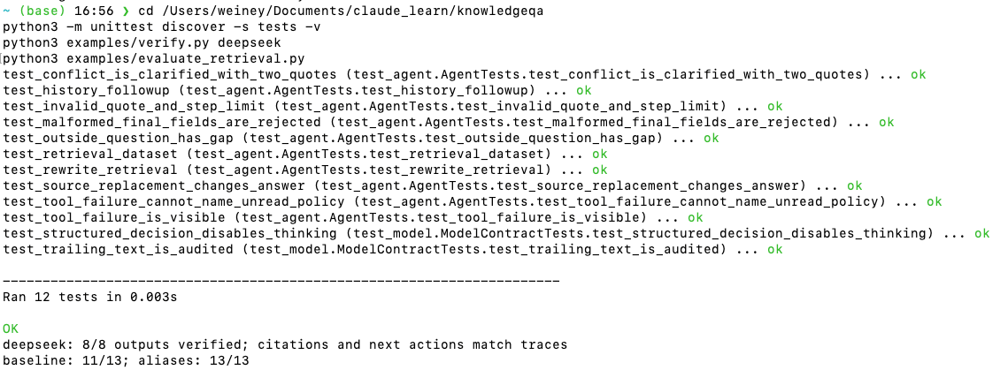
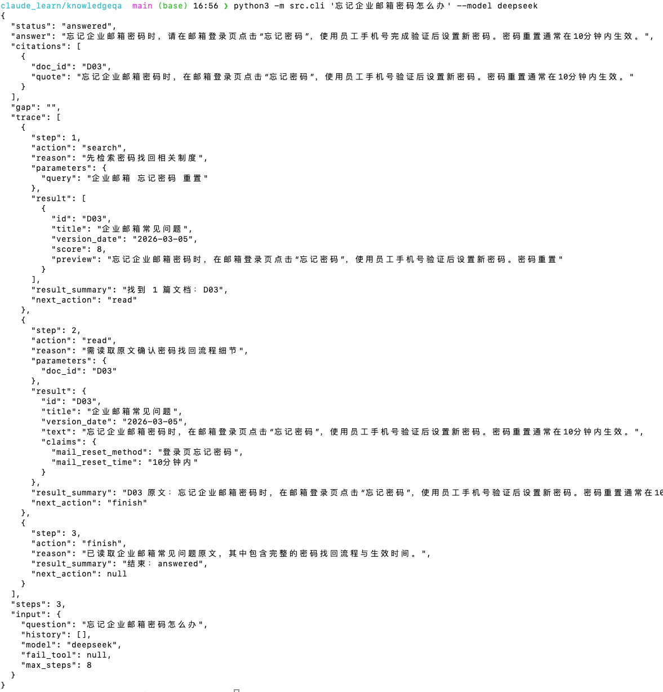
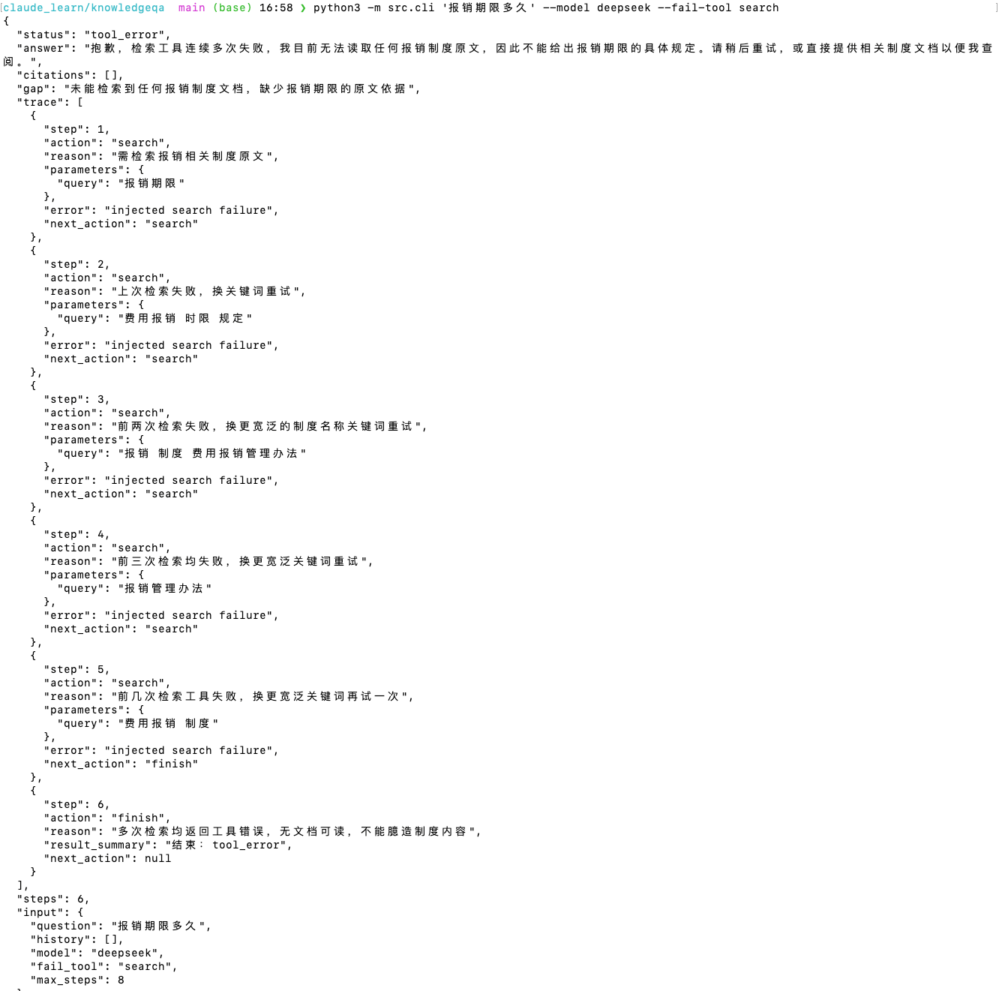

# 03 评估：预期、实测与限制

评测日期：2026-10-28。命令：`python3 -m unittest discover -s tests -v`，结果 12/12 通过；`python3 examples/verify.py deepseek`，8/8 条已保存的实际输出通过状态、引用与 Trace 核验。真实模型使用 `deepseek-flash`、温度 0、关闭思考模式、JSON Output；资料为 `data/documents.json`。每个链接含输入、实际输出和逐步 Trace，不能把 Mock 结果当作模型决策证据。

| 验收点 | 预期 | 真实模型实际结果 |
| --- | --- | --- |
| 明确答案 | 读取 FAQ 后回答并引用 | [clear_answer.json](../examples/deepseek/clear_answer.json)：`answered`，`search → read D03 → finish` |
| 文档冲突 | 同时引用 D01/D02，要求确认制度 | [conflict.json](../examples/deepseek/conflict.json)：`needs_clarification`，`search → read D01 → read D02 → ask_clarification` |
| 资料外问题 | 说明缺口 | [outside.json](../examples/deepseek/outside.json)：`insufficient_data`，多次补充检索后结束 |
| 改写问题 | 找到邮箱 FAQ | [rewrite.json](../examples/deepseek/rewrite.json)：`answered`，引用 D03 |
| 上下文追问 | 关联邮箱密码重置并回答生效时间 | [followup.json](../examples/deepseek/followup.json)：`answered`，引用 D03 |
| 工具失败 | 报错并不给无依据答案 | [tool_failure.json](../examples/deepseek/tool_failure.json)：`tool_error`，多次不同查询均收到注入故障后结束 |
| 步数上限 | 返回明确未完成状态 | [step_limit.json](../examples/deepseek/step_limit.json)：`--max-steps 1` 后返回 `incomplete` |

两条核心路径的动作由真实模型在看到不同工具结果后生成；它们分别保存在 `clear_answer.json` 和 `conflict.json`。额外的资料替换实验将 D02 的期限及逾期规则改为与 D01 相同，模型从 `ask_clarification` 改为 `finish` 并回答 30 天，见 [source_changed.json](../examples/deepseek/source_changed.json) 和 [替换资料](../data/variants/aligned_documents.json)。这检验了答案与动作对原文变化的响应。

检索改进：`python3 examples/evaluate_retrieval.py` 在 [13 个固定问题](../data/retrieval_cases.json)上比较无同义词基线与当前实现。预期是相关文档进入前 3（冲突题要求 D01 和 D02 都进入前 3），资料外题要求无结果。实际为基线 11/13、当前实现 13/13，逐题结果见 [retrieval_evaluation.json](../examples/retrieval_evaluation.json)。样本小且由本项目设计，不能推断真实企业语料的召回率。

## 现场运行截图

以下三张由候选人于 2026-10-28 在终端实际运行后截取，作为补充材料。案例截图与仓库中保存的 JSON Trace 是同类用例的独立运行；模型查询词和重试次数可能不同。完整可核验数据仍以对应 JSON Trace 和测试代码为准。

**测试、样例核验与检索评测**：12 个测试通过，8/8 条真实模型样例通过核验，检索对比为 11/13 → 13/13。

**明确答案**：现场运行返回 `answered`，引用 D03，Trace 展示 `search → read → finish`。

**工具失败**：现场注入 `search` 故障后返回 `tool_error`，未给出无原文依据的报销期限。

## 失败、修复与限制

- 初版接入未显式关闭 DeepSeek 默认开启的思考模式。首次批量运行及一次单独重试中，上下文追问返回非单一 JSON；复测初版时，7 例中有 5 例因额外文本导致 `model_error`。依据 [DeepSeek Chat Completions 文档](https://api-docs.deepseek.com/api/create-chat-completion/)增加 `thinking: disabled`、JSON Output 与 `max_tokens` 后稳定性改善；再次扩大运行仍观察到一次 JSON 后附加文本。现仅解析首个有效 JSON 对象并在发生时记录 `format_warning`，有回归测试覆盖。首个对象无效仍返回 `model_error`，不能保证未来每次模型输出都正确。
- 一次资料替换重跑遇到 TLS 连接中断，程序返回 `model_error`；单独重跑成功。真实模型测试依赖网络，连接故障仍需人工重跑。
- 最新资料外问题进行了多次检索，能说明缺口但成本偏高；后续可加无结果次数预算。
- 本地双字片段检索只在这套小型合成资料上验证，未测大规模资料、多语言或复杂适用范围。引用校验保证逐字存在，不保证所有自然语言推论都正确。
- `MockModel` 的 [离线结果](../examples/mock/summary.json) 仅用于程序流程和故障注入检查。
- 真实模型运行依赖网络与个人 API Key；评审可用 Mock 完全离线复现工具流程，再自行配置 DeepSeek 复现实验。
